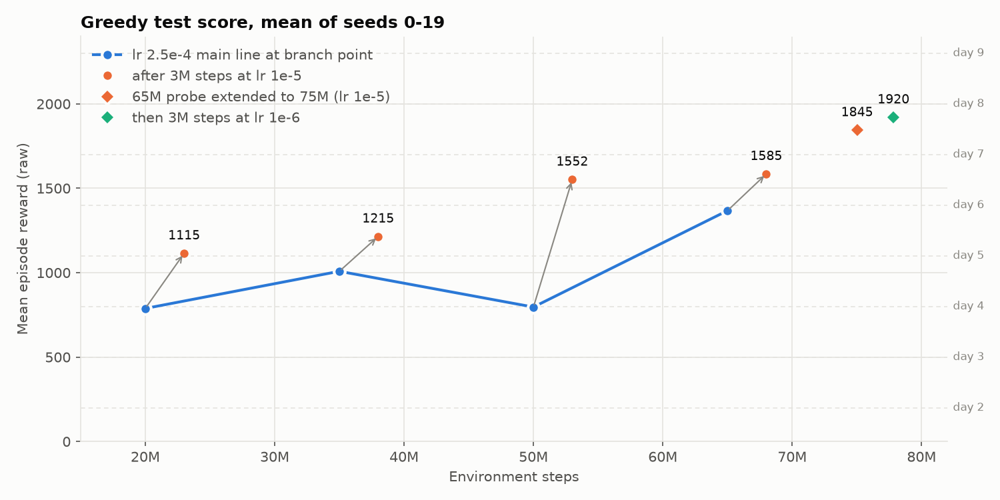
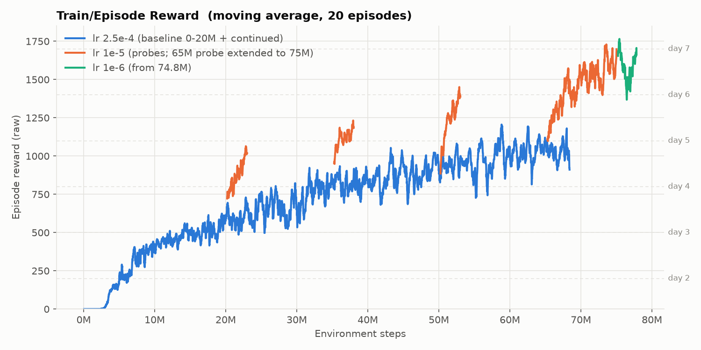

# RESULTS — Lab 3 PPO on Enduro-v5

> Baseline 完成時間：2026-10-24 13:15；額外實驗（§8）完成時間：2026-10-26 22:36。過程紀錄詳見 `NOTES.md`。
> **重點**：
> - Baseline（助教超參數，20M）：`best.pth`（依訓練中 3 場評估選出，15.0M）並不是最強的模型；最後的 20M checkpoint 明顯較好（seed 0~19 平均 788，最多第 4 天）。
> - **額外實驗（使用者同意）：分段降低學習率續訓**（2.5e-4 → 1e-5 → 1e-6，§8）→ seed 0~19 平均 **1920**，4 個 seed 到**第 9 天（demo 滿分 50）**。
> - **最終 demo：`Enduro_lr1e-5_from65M_then_lr1e-6/checkpoints/model_77830590_1533.pth` + seed 12 + greedy → 2339 分，第 9 天**（§8.4）。

---

## 1. 實作摘要

所有 `### TODO ###` 與助教提示註解都原樣保留（已用 `diff lab03/src src` 確認原始行沒有被改寫）。說明註解一律以 `# [說明]` 開頭。

| TODO | 檔案 | 內容 |
|---|---|---|
| 收集 transition | `base_agent.py` `train()` | `decide_agent_actions` → `env.step(action[0])`；存進 buffer 的 reward 取 `sign`（clip），`episode_reward` 仍累加原始 reward |
| 存 buffer | `base_agent.py` `train()` | `observation / action / reward / value / logp_pi / done(=terminate or truncate)`，全部為純量（維度一致） |
| forward | `models/atari_model.py` | 給 `a` → 算該動作 log prob（update 用）；`eval=True` → argmax；否則從 `Categorical(logits)` 取樣。回傳 action, log π, V, entropy |
| env / test_env | `ppo_agent_atari.py` `__init__` | `make_atari_env()`：`frameskip=1` + `AtariPreprocessing`（灰階、84×84、skip 4、noop 30）+ `FrameStack(4)` → (4, 84, 84)；test_env 用 `rgb_array`（sample 的 `evaluate()` 每步呼叫 `render()`） |
| decide_agent_actions | `ppo_agent_atari.py` | 加 batch 維度 (1, 4, 84, 84)，`no_grad` forward，回傳 numpy `(1,)` 的 action / value / logp |
| update | `ppo_agent_atari.py` | ratio = exp(logp_new − logp_old)、clipped surrogate、MSE value loss、entropy bonus、minibatch advantage normalization、grad clip 0.5；另記錄 approx KL 與 clip fraction |

額外技巧與功能：
- **前處理**：灰階 + resize 84×84 + frame stack 4 + reward clipping（只在訓練 buffer）+ noop reset。frame skip 只做一次，sticky action 0.25 維持 v5 預設。
- **初始化**：sample code 已是 orthogonal(√2)；另把 actor 輸出層設 gain 0.01（初始 policy 近均勻）、critic 輸出層 gain 1。
- **GAE**：助教已在 `gae_replay_buffer.py` 實作（不在 TODO 範圍），只補上 `[說明]` 註解（δ、遞迴、return、horizon 切段）。
- **新增檔案**：`atari_wrappers.py`（前處理）、`test.py`（測試/錄影/seed 掃描）、`export_plots.py`（匯出曲線）、`tb_utils.py`（續訓時整理 log）、`run_train.ps1`（自動續訓監督腳本）。
- **新增函式**（`base_agent.py`）：每 500k 步評估、`best.pth`、可續訓的 `last.pt`（含 optimizer、步數；只在 update 結束時存，續訓不丟資料）。

「Horizon 128 vs 每 10000 步更新」的解讀：單環境收集 10000 步後 update 一次（3 epoch × 79 個 minibatch）；horizon 128 只用在 buffer 裡把每條 trajectory 切成 128 步的片段算 GAE（片段尾端用 V(s_{t+128}) bootstrap）。

## 2. Breakout 驗證（PPO 正確性）✅

| 項目 | 值 |
|---|---|
| 設定 | `ALE/Breakout-v5`，預設超參數，3M steps |
| 訓練時間 / SPS | 2.4 h / 341 SPS |
| 評估分數 (3 場 greedy) | 250k: 9.0 → 1.5M: 22.7 → 2.0M: 24.0 → **3.0M: 40.7** |
| 訓練曲線 (20 場移動平均) | ~1 → ~30 |
| `test.py` 5 場 (seed 0) | 48 / 14 / 17 / 6 / 47，平均 26.4 |

random 約 1~2 分，1.5M 起穩定 > 20 分 → 通過，不需除錯。（test 第 4 場的 6 分是 greedy policy 掉球後不按 FIRE 發球、卡到 27000 步上限，Breakout 特有，Enduro 不受影響。）

## 3. Enduro 訓練結果

### 3.1 訓練概況
| 項目 | 值 |
|---|---|
| 總步數 | **20,000,472** |
| 有效訓練時間 | 60,612 s（16.8 h，含評估）；實際牆鐘 10/23 19:28 → 10/24 12:44（含一次中斷損失約 25 分鐘） |
| 平均 SPS | **330**（單環境，GPU forward 受 Windows 啟動延遲限制） |
| 評估 | 每 500k 步，3 場 greedy，原始 reward |
| 中斷 | 1 次（使用者關掉了訓練程序的空白主控台視窗），從 checkpoint 續訓，之後改隱藏視窗 + 自動續訓 |

學習過程：0~2.5M 評估皆為 0（正常）→ 3.0M 20 → 5.0M 241 → 8.0M 430 → 13M 起 550~780 震盪。

### 3.2 Checkpoint 比較（關鍵發現）
訓練中的評估只有 3 場，雜訊很大，因此對評估分數最高的幾個 checkpoint 都做了多 seed 測試（greedy）：

| checkpoint | 訓練中評估 (3 場) | seed 掃描平均 | 到第 4 天的比例 |
|---|---|---|---|
| **`best.pth` = 15.0M** | **776.3**（最高） | 553.9（20 seeds） | 0/20 |
| 13.0M | 714.0 | 631.3（10 seeds） | 0/10 |
| 13.5M | 714.3 | 537.6（10 seeds） | 0/10 |
| 17.0M | 733.0 | 682.1（10 seeds） | 0/10 |
| 17.5M | 756.3 | 696.6（10 seeds） | 0/10 |
| **20.0M（最後）** `model_20000472_729.pth` | 729.3 | **788.1（20 seeds）** | **7/20** |

→ `best.pth` 的 776 是 3 場運氣好的結果；**20M checkpoint 才是實際最強的模型**。`best.pth` 依規格保留不動，demo 改用 20M checkpoint。

### 3.3 5 場測試結果（助教格式，seed 0，greedy）

**20M checkpoint（建議使用）**
```
Episode: 1	Length: 13307	Total reward: 948.00
Episode: 2	Length: 13312	Total reward: 928.00
Episode: 3	Length: 13312	Total reward: 949.00
Episode: 4	Length: 9977	Total reward: 764.00
Episode: 5	Length: 9981	Total reward: 780.00
average score: 873.8
```

`best.pth`（15.0M，對照）
```
Episode: 1	Length: 9979	Total reward: 783.00
Episode: 2	Length: 9984	Total reward: 753.00
Episode: 3	Length: 6656	Total reward: 496.00
Episode: 4	Length: 9977	Total reward: 630.00
Episode: 5	Length: 6653	Total reward: 477.00
average score: 627.8
```

### 3.4 Seed 掃描（20M checkpoint，1 場 / seed）

天數有兩種算法且全部一致：依評分表的 reward 區間，以及依 episode 長度（每天約 3326 步，遊戲只會在某天結束時沒達標才結束）。
已用錄影畫面確認：seed 6 最後一格儀表板顯示「第 4 天、剩 109 台」（200 + 300 + 300 + 191 = 991 ≈ 994）。

| seed | greedy reward | 長度 | 天數 | demo 分數 | | stochastic reward | 天數 |
|---|---|---|---|---|---|---|---|
| 0 | 948 | 13307 | 4 | 25 | | 491 | 2 |
| 1 | 942 | 13311 | 4 | 25 | | 410 | 2 |
| 2 | 972 | 13308 | 4 | 25 | | 492 | 2 |
| 3 | 937 | 13306 | 4 | 25 | | 495 | 2 |
| 4 | 728 | 9984 | 3 | 20 | | 459 | 2 |
| 5 | 791 | 9977 | 3 | 20 | | 787 | 3 |
| **6** | **994** | **13307** | **4** | **25** | | 496 | 2 |
| 7 | 788 | 9981 | 3 | 20 | | 756 | 3 |
| 8 | 743 | 9983 | 3 | 20 | | 493 | 2 |
| 9 | 770 | 9978 | 3 | 20 | | 703 | 3 |
| 10 | 758 | 9978 | 3 | 20 | | 470 | 2 |
| 11 | 491 | 6654 | 2 | 10 | | 451 | 2 |
| 12 | 788 | 9981 | 3 | 20 | | 750 | 3 |
| 13 | 957 | 13311 | 4 | 25 | | 441 | 2 |
| 14 | 788 | 9977 | 3 | 20 | | 772 | 3 |
| 15 | 720 | 9978 | 3 | 20 | | 766 | 3 |
| 16 | 498 | 6652 | 2 | 10 | | 797 | 3 |
| 17 | 473 | 6649 | 2 | 10 | | 743 | 3 |
| 18 | 932 | 13307 | 4 | 25 | | 483 | 2 |
| 19 | 744 | 9977 | 3 | 20 | | 741 | 3 |
| **平均** | **788.1** | | | | | 599.8 | |

- greedy 明顯優於 stochastic（取樣的隨機性在後期反而害它撞車），demo 用 greedy（`test.py` 預設）。
- 結果可重現：seed 0~9 在兩次獨立掃描中完全相同；seed 6 加上錄影後仍是 994 / 13307 步。
- 完整 CSV：`runs/Enduro_release/seed_sweep_*.csv`；log：`runs/Enduro_release/sweep_logs/`

### 3.5 Baseline 的推薦 demo 設定與預估分數

> 這是只用助教超參數（baseline）時的建議；**最終 demo 改用 §8.4 的模型（第 9 天，50 分）**，這組當作備案。

**`model_20000472_729.pth` + seed 6 + greedy → 994 分，第 4 天結束 → demo 表現分數 25 / 50。**

（評分表：第 2 天 10、第 3 天 20、第 4 天 25、每多一天 +5、第 9 天 50。seed 0/1/2/3/13/18 也都是第 4 天、25 分，可當備用。）

Demo 指令（在 `src/` 下，先啟用 `.venv`）：
```powershell
# 即時顯示 (ALE 視窗，真實速度，13307 步約 15 分鐘)
python test.py --exp-name Enduro_release --ckpt ..\runs\Enduro_release\checkpoints\model_20000472_729.pth --episodes 1 --seed 6 --render
# 加速顯示 (OpenCV 視窗，4 倍速約 3.7 分鐘，畫面上顯示分數/步數/天數；結果相同)
python test.py --exp-name Enduro_release --ckpt ..\runs\Enduro_release\checkpoints\model_20000472_729.pth --episodes 1 --seed 6 --display-fps 60
# 錄影 (存到 runs\Enduro_release\videos\)
python test.py --exp-name Enduro_release --ckpt ..\runs\Enduro_release\checkpoints\model_20000472_729.pth --episodes 1 --seed 6 --record
# 5 場測試 (報告用) / seed 掃描
python test.py --exp-name Enduro_release --ckpt ..\runs\Enduro_release\checkpoints\model_20000472_729.pth --episodes 5 --seed 0
python test.py --exp-name Enduro_release --ckpt ..\runs\Enduro_release\checkpoints\model_20000472_729.pth --sweep 0 19
```
已錄好的 demo 影片：`runs/Enduro_release/videos/seed6_greedy-episode-0.mp4`（30 fps，2 倍速，約 7.4 分鐘）。

## 4. 圖表（matplotlib 備份）

- Enduro：`runs/Enduro_release/train_reward.png`、`runs/Enduro_release/eval_reward.png`
- Breakout：`runs/Breakout_ppo/train_reward.png`、`runs/Breakout_ppo/eval_reward.png`
- 重新匯出：`python src/export_plots.py --exp-name Enduro_release`
- 額外實驗（§8）：`runs/lr_decay/lr_decay_train_reward.png`、`lr_decay_eval_reward.png`、`lr_decay_probe_scores.png`
  （重新匯出：`python src/plot_lr_decay.py`）

## 5. TensorBoard

```powershell
cd C:\Users\User\Desktop\RL_Lab3_PPO
.venv\Scripts\tensorboard.exe --logdir runs\Enduro_release\tb
# 或同時看 Breakout 與 §8 的所有分段（每個實驗一條曲線，續訓的曲線接在分支點後面）：--logdir runs
```
瀏覽器開 http://localhost:6006 。報告要截的 tag：`Train/Episode Reward`、`Evaluate/Episode Reward`（另有 `PPO/*` 各項 loss、`PPO/Approx KL`、`PPO/Clip Fraction`、`Train/SPS`）。
中斷造成的重疊區段已剪掉（原檔在 `runs/Enduro_release/tb_backup/`），曲線是乾淨的一條。

## 6. 問題與觀察

1. **訓練中斷**：使用者關掉了一個空白的主控台視窗（就是訓練程序），python 被一起結束。
   之後加了：隱藏視窗啟動、`run_train.ps1` 自動續訓、每 200k 步存 `last.pt`、續訓時剪掉 TensorBoard/eval_log 的重疊紀錄。
2. **`best.pth` 選錯**：3 場評估的變異太大（同一個模型單場可以是 480 或 780）。多 seed 測試後，20M 比 15M 好約 230 分。
3. **policy 更新偏激進**：approx KL 由前期 0.014 升到 0.035~0.039，clip fraction 0.27~0.32（Breakout 末期 0.19）。
   10000 筆 × 3 epoch × 79 minibatch = 每次 update 237 步梯度，policy 每次移動較大；評估分數 13M 後在 460~780 間震盪，可能與此有關。
4. **還沒收斂**：訓練曲線 20 場移動平均在 18~20M 仍上升（12~15M 平均 474 → 18~20M 平均 531，最後 ~600），最新的 checkpoint 也是最強的。
5. **卡在第 3~4 天**：幾乎所有 episode 都結束在第 2/3/4 天的終點（長度 6650 / 9980 / 13310），reward 很少超過 1000。
   以 20M checkpoint 來看：第 3 天結束的 episode 當天超了約 220~290 台（差一點達標 300），
   到第 4 天的 episode 當天只超了約 130~190 台。
6. **greedy > stochastic**：entropy 末期仍有 ~1.2（log 9 = 2.2），取樣時常出錯，所以評估/測試用 argmax 明顯較好。
7. **刻意保留的 sample code 行為**：update 時只在 epoch 外 shuffle 一次（3 個 epoch 的 minibatch 切法相同）；
   terminal 那一步不計入 `total_time_step`；truncate 也當作 done（GAE 不 bootstrap）。對結果影響都很小。
8. **環境**：沒有 conda，改用 Python 3.11 venv（套件版本與指定完全相同）；系統缺 VC++ runtime，用 venv 內的 DLL 解決（見 NOTES §1）。

## 7. 調參建議（baseline 完成時寫的）

> 之後經使用者同意，建議 1（繼續訓練）與建議 2 的「降低 learning rate」以「分段降學習率」的形式執行了，結果見 §8。

1. **繼續訓練到 30~40M（最優先，成本最低）**：曲線還在上升、最新 checkpoint 最強。不用改任何超參數：
   先刪掉 `runs\Enduro_release\checkpoints\DONE`（否則監督腳本會直接結束），再執行
   `powershell -ExecutionPolicy Bypass -File src\run_train.ps1 -ExpName Enduro_release -Steps 40000000`，
   就會從 20M 的 `last.pt` 接續（含 optimizer 狀態）。以 330 SPS 計，每多 10M 約 8.5 小時。
   （若想保留 20M 的結果當對照，可先把 `runs\Enduro_release` 複製一份。）
2. **讓 policy 更新溫和一點**：KL ~0.04、clip fraction ~0.3 偏高。可擇一：learning rate 2.5e-4 → 1e-4、
   或加上線性 learning-rate annealing（PPO Atari 的標準做法）、或每個 epoch 重新 shuffle minibatch。
   預期評估分數震盪變小、後期能穩定進步。
3. **加大評估場數挑模型**：`--eval-episode 3 → 10`（或對最後幾個 checkpoint 做 seed 掃描，如這次的做法）。
   這不影響學習，但能避免像 `best.pth` 這樣被 3 場雜訊誤導，demo 選到真正最強的模型。
   （次要方向：entropy coefficient 0.01 → 0.005，讓 policy 後期更確定，縮小 greedy 與 stochastic 的落差。）

## 8. 額外實驗：分段降低學習率續訓（使用者同意，10/24 16:44 → 10/26 22:36）

### 8.1 動機與做法
參考往年修課者的做法（2.5e-4 訓練 100M → 1e-5 續訓 40M → 1e-6 續訓 60M）。從對方曲線看到：降到 1e-5 後的**前 2M 步**就大幅跳升，之後收益很小；1e-6 只在一開始跳一次。
我們的時間只夠約 1/3 的步數，所以用「短探測」決定何時降學習率，把預算花在收益大的地方：

1. **主線**：從 baseline 20M 的 `last.pt`（含 Adam 狀態）用 lr 2.5e-4 繼續訓練（`Enduro_lr2.5e-4_cont`）。
2. **探測**：在 20M / 35M / 50M / 65M 從主線分支，lr 1e-5 跑 3M 步（`Enduro_lr1e-5_from<N>M`），與主線並行（兩個訓練同時跑，合計約 1.65 倍速度）。
3. **打分數**：分支點與探測結束都用 `test.py --sweep 0 19`（greedy）測 20 個固定 seed（不用訓練中只有 3 場的評估，見 §3.2）。
4. **停損**：探測分數比上一個探測進步 < 100（約 1/3 天）就停掉主線。
5. **收尾**：最好的探測用 1e-5 延長到分支點 + 10M，再分支用 1e-6 跑 3M。

整個流程由 `src/lr_decay_schedule.py` 自動執行（狀態、log、探測結果在 `runs/lr_decay/`）。超參數只有 learning rate 改變，其餘都是助教設定。
程式變更都不在 TODO 區塊：`main.py` 新增 `--learning-rate`（預設 2.5e-4）與 `--init-from`；新檔 `finetune_utils.py`（分支載入、重設學習率）、`lr_decay_schedule.py`、`plot_lr_decay.py`；`run_train.ps1` 多兩個參數。

### 8.2 探測結果（seed 0~19 greedy 平均）

| 分支點 | 主線（lr 2.5e-4）在分支點 | 降到 1e-5 跑 3M 後 | 降學習率的增幅 | 比上一個探測 | 天數分布（降學習率後） |
|---|---|---|---|---|---|
| 20M | 788.1 | 1114.8 | +327 | – | 第 3 天 2、第 4 天 12、第 5 天 5、第 6 天 1 |
| 35M | 1008.2 | 1214.9 | +207 | +100.1 → 繼續 | 第 4 天 11、第 5 天 8、第 6 天 1 |
| 50M | 796.4 | 1551.8 | +755 | +336.9 → 繼續 | 第 4~8 天 |
| 65M | 1367.5 | 1585.1 | +218 | **+33.2 → 停損** | 第 4~8 天 |



- 降學習率**每次都立刻大幅加分**（+207 ~ +755），而且 3M 步內就看得到，和參考曲線一致。
- 主線本身分數震盪很大（50M 的 796 比 35M 的 1008 還低），但從它分出的探測分數仍穩定上升 → 「降學習率後再測」比直接看主線可靠。
- 主線停在 68.4M（實際比預定的 10/28 截止提早約 1 天停）。

### 8.3 收尾結果

| 模型 | 步數 | seed 0~19 平均 | 天數分布 | 平均 demo 分數 |
|---|---|---|---|---|
| Baseline 20M（對照） | 20.0M | 788.1 | 第 2~4 天 | – |
| 65M 探測（1e-5，3M） | 68.0M | 1585.1 | 第 4~8 天 | – |
| 65M 探測延長（1e-5） `Enduro_lr1e-5_from65M` | 75.0M | 1844.6 | 第 4 天 2、第 5 天 1、第 6 天 3、第 7 天 10、第 8 天 4 | 38.3 |
| **再接 1e-6 3M** `Enduro_lr1e-5_from65M_then_lr1e-6` | **77.8M** | **1920.3** | 第 5 天 4、第 6 天 1、第 7 天 9、第 8 天 2、**第 9 天 4** | **40.3** |

1e-6 階段的 approx KL 約 0.00003、clip fraction 0，policy 幾乎不再變動；平均多 76 分，在 seed 雜訊範圍內，但到第 9 天的 seed 從 0 個變成 4 個。



**最終模型 5 場測試（助教格式，seed 0，greedy）**
```
Episode: 1	Length: 16635	Total reward: 1387.00
Episode: 2	Length: 16640	Total reward: 1380.00
Episode: 3	Length: 23296	Total reward: 1919.00
Episode: 4	Length: 23289	Total reward: 1846.00
Episode: 5	Length: 23293	Total reward: 1846.00
average score: 1675.6
```

**最終模型 seed 掃描（1 場 / seed，greedy）**

| seed | 0 | 1 | 2 | 3 | 4 | 5 | 6 | 7 | 8 | 9 | 10 | 11 | 12 | 13 | 14 | 15 | 16 | 17 | 18 | 19 |
|---|---|---|---|---|---|---|---|---|---|---|---|---|---|---|---|---|---|---|---|---|
| reward | 1387 | 2208 | 1987 | 1349 | 1391 | 1926 | **2322** | 1913 | 1977 | 1926 | **2323** | 1929 | **2339** | 1973 | 1682 | 1975 | 1902 | 2170 | 1399 | **2327** |
| 天數 | 5 | 8 | 7 | 5 | 5 | 7 | **9** | 7 | 7 | 7 | **9** | 7 | **9** | 7 | 6 | 7 | 7 | 8 | 5 | **9** |

### 8.4 最終推薦 demo 設定

**`runs/Enduro_lr1e-5_from65M_then_lr1e-6/checkpoints/model_77830590_1533.pth` + seed 12 + greedy → 2339 分，第 9 天 → demo 表現分數 50 / 50。**

- 備用 seed：19（2327）、10（2323）、6（2322），也都是第 9 天。
- 四個第 9 天 seed 各自的 test log（單獨執行 `test.py --episodes 1 --seed N`，結果與掃描完全相同）：
  `runs/Enduro_lr1e-5_from65M_then_lr1e-6/test_logs/test_seed{6,10,12,19}.log`
- 報告「Testing results (5 games)」用：`test_logs/test_5games_seed12.log`（與 demo 同一個 seed，2339 / 1687 / 1986 / 1656 / 1884，平均 **1910.4**）；
  另有 `test_logs/test_5games_seed0.log`（預設 seed 0，平均 1675.6）。`test.py` 只在第 1 場用指定 seed reset，第 2~5 場接續同一個 RNG。
- 可重現：seed 12 加上錄影後重跑仍是 2339 / 26997 步。
- 這場跑到 108000 frames 的時間上限（26997 步）才被截斷 → 在時間限制內已玩到最遠的第 9 天。錄影最後一格儀表板顯示「第 9 天、剩 261 台」。
- 已錄好的影片：`runs/Enduro_lr1e-5_from65M_then_lr1e-6/videos/seed12_greedy-episode-0.mp4`（30 fps，2 倍速，約 15 分鐘）。

Demo 指令（在 `src/` 下，先啟用 `.venv`）：
```powershell
$ck = "..\runs\Enduro_lr1e-5_from65M_then_lr1e-6\checkpoints\model_77830590_1533.pth"
# 即時顯示 (ALE 視窗，真實速度，26997 步約 30 分鐘)
python test.py --exp-name Enduro_lr1e-5_from65M_then_lr1e-6 --ckpt $ck --episodes 1 --seed 12 --render
# 加速顯示 (OpenCV 視窗，4 倍速約 7.5 分鐘，畫面上顯示分數/步數/天數；結果相同)
python test.py --exp-name Enduro_lr1e-5_from65M_then_lr1e-6 --ckpt $ck --episodes 1 --seed 12 --display-fps 60
# 5 場測試 (報告用)
python test.py --exp-name Enduro_lr1e-5_from65M_then_lr1e-6 --ckpt $ck --episodes 5 --seed 0
```

### 8.5 成本
- 額外環境步數約 70M（主線 48.4M + 探測 4 × 3M + 延長 7M + 1e-6 3M），牆鐘約 54 小時（10/24 16:44 → 10/26 22:36），期間沒有中斷。
- 參考做法共用 200M 步；這次總共 77.8M 步就到第 9 天，主要省在：用 3M 步的探測取代長時間的低學習率訓練，以及 1e-6 只跑 3M。

---

### 檔案位置總覽
```
src/                          繳交用原始碼（含 TODO 實作）
lab03/src/                    助教原始 sample code（未改動，對照用）
runs/Breakout_ppo/            Breakout 驗證（checkpoints/ tb/ train.log 曲線 PNG）
runs/Enduro_release/
  checkpoints/best.pth        訓練中評估最高（15.0M, 776）
  checkpoints/model_20000472_729.pth   ← 建議 demo 使用（20M）
  checkpoints/last.pt         可續訓的完整狀態（20M）
  checkpoints/eval_log.csv    每次評估的 (步數, 分數, 累計秒數)
  tb/  videos/  sweep_logs/  seed_sweep_*.csv  train_reward.png  eval_reward.png  train.log
runs/Enduro_lr2.5e-4_cont/    §8 主線（20M → 68.4M，lr 2.5e-4），checkpoints/branch_<N>M.pt 為各分支點
runs/Enduro_lr1e-5_from<N>M/  §8 探測（lr 1e-5）；from65M 延長到 75.0M
runs/Enduro_lr1e-5_from65M_then_lr1e-6/
  checkpoints/model_77830590_1533.pth  ← 最終 demo 使用（77.8M）
  videos/seed12_greedy-episode-0.mp4   ← demo 錄影
runs/lr_decay/                §8 排程器 log、state、probes.csv、圖表
.venv/                        Python 環境
```
